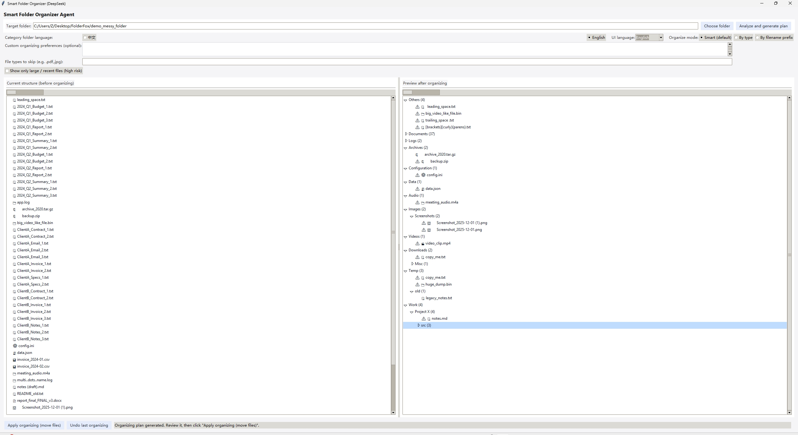
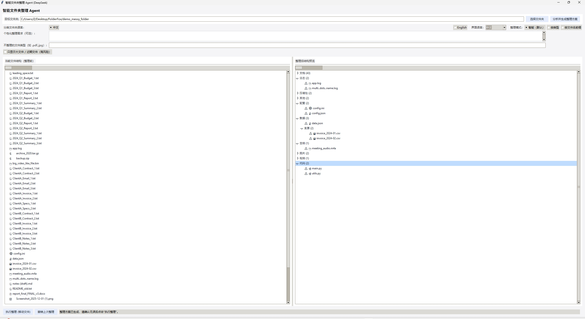

# Intelligent Folder Organizer Agent (DeepSeek-powered)

This project is a **desktop file organization assistant** built with Python and Tkinter. It scans a target folder, analyzes file names, types, sizes, and samples of their contents, then calls the **DeepSeek** model (via the OpenAI-compatible API) to generate an intelligent folder structure and move files into appropriate subfolders.



## Features

- **Visual desktop UI**: Modern, clean Tkinter interface with left/right trees showing the folder structure *before* and *after* organizing.
- **DeepSeek-powered organization**: Uses `DeepSeekClient` to send file metadata and samples to the DeepSeek model and receive a structured organization plan.
- **Flexible organizing modes**:
  - `standard`: Balanced, human-friendly categories (documents, images, videos, code, archives, others, etc.).
  - `by_type`: Organize primarily by file type/extension (e.g. `Documents/PDF`, `Images/PNG`, `Code/Python`).
  - `by_prefix`: Group by filename prefixes (e.g. project codes, date prefixes, business prefixes).
- **Language control**: Choose whether suggested subfolder names are in **English** or **Simplified Chinese**.
- **Personalized instructions**: Optional free-text area where you can describe custom organizing preferences.
- **Risk-focused filtering**: Option to only show **large files** or **recent files** as “high risk” candidates.
- **Safe execution & undo**:
  - Preview the plan before moving any files.
  - One-click **execute** to create subfolders and move files.
  - **Undo last organize** to move files back when possible.

## Project Structure

- `file_organizer_agent.py`  
  Main Tkinter GUI application. Handles:
  - Scanning the target folder recursively.
  - Displaying the original and planned folder structures.
  - Calling `DeepSeekClient.organize_files` in a background thread.
  - Executing the move operations and supporting undo.

- `deepseek_client.py`  
  Lightweight wrapper around the DeepSeek Chat API (OpenAI-compatible client). Responsible for:
  - Loading the API key from environment variables or a local file.
  - Building robust system prompts in English/Chinese.
  - Sending file metadata to the model and parsing the JSON response.

- `deepseek_api_key.txt` (optional, **not committed to VCS**)  
  Helper file to store your DeepSeek API key in plain text (first line only), if you do not want to use environment variables.

## Requirements

Python 3.10+ is recommended.

Install dependencies:

```bash
pip install -r requirements.txt
```

The minimal runtime dependencies are:

- `openai` – Official OpenAI-compatible client used for calling the DeepSeek API.
- Standard library modules: `tkinter`, `threading`, `pathlib`, `shutil`, `os`, `time`, `textwrap`, `dataclasses`, `typing` (bundled with Python; no extra install).

## DeepSeek API Configuration

The application requires a **DeepSeek API key** to call the model. The key is resolved in the following order:

1. Explicit `api_key` passed to `DeepSeekClient` (not used in the default GUI).
2. Environment variable `DEEPSEEK_API_KEY`.
3. Environment variable `DEEPSEEK_API_KEY_FILE` pointing to a file that contains the key on the first line.
4. A `deepseek_api_key.txt` file located either:
   - In the same directory as `deepseek_client.py`, or
   - In the current working directory.

If no key is found, the app will raise a clear error explaining how to configure it.

### Example: Set environment variable (Windows PowerShell)

```powershell
$env:DEEPSEEK_API_KEY = "YOUR_API_KEY_HERE"
python file_organizer_agent.py
```

### Example: Use `deepseek_api_key.txt`

1. Create a file named `deepseek_api_key.txt` in the project root.
2. Put your API key on the **first line** of this file.
3. Run:

```bash
python file_organizer_agent.py
```

## How to Run

1. Make sure Python 3.10+ and dependencies are installed.
2. Configure the DeepSeek API key (see section above).
3. In the project root, run:

```bash
python file_organizer_agent.py
```

4. In the GUI:
   - Click **“选择文件夹”** to pick the folder you want to organize.
   - Optionally:
     - Choose the language for subfolder names (Chinese/English).
     - Select organizing mode (standard/by type/by prefix).
     - Specify file types to **skip** (e.g. `.pdf,.jpg`).
     - Enter custom organizing requirements in the text box.
   - Click **“分析并生成整理方案”** to let DeepSeek generate the plan.
   - Inspect the **before** (left) and **after** (right) trees.
   - When satisfied, click **“执行整理 (移动文件)”** to perform the moves.
   - If needed, click **“撤销上次整理”** to rollback the previous operation.

## Safety Notes

- The tool uses `shutil.move`, which **physically moves** files on disk. Always double-check the preview tree before executing.
- If a target file already exists in the destination folder:
  - If it’s the same file (same path) or same size, the move is skipped.
  - Otherwise a suffix like `_1`, `_2`, … is appended to avoid overwriting.
- Use version control or backups for critical folders whenever possible.

---

# 智能文件夹整理 Agent（基于 DeepSeek）

本项目是一个基于 Python 和 Tkinter 的**桌面文件整理助手**。它会扫描目标文件夹，分析文件名、类型、大小及部分内容片段，然后通过兼容 OpenAI 接口的 **DeepSeek** 模型生成智能整理方案，将文件移动到合适的子文件夹中。



## 功能特点

- **可视化桌面界面**：简洁现代的 Tkinter UI，左侧展示整理前结构，右侧展示整理后预览。
- **DeepSeek 智能分类**：通过 `DeepSeekClient` 将文件元数据和内容样本发送给 DeepSeek 模型，获取详细的整理方案。
- **多种整理模式**：
  - `standard`：更贴近日常使用习惯的综合分类（文档、图片、视频、代码、压缩包、其他等）。
  - `by_type`：按文件类型/扩展名进行精细分类（如 `文档/PDF`、`图片/PNG`、`代码/Python` 等）。
  - `by_prefix`：按文件名前缀分组（如项目编号、日期前缀、业务前缀等）。
- **分类语言可选**：可选择使用 **英文** 或 **简体中文** 作为推荐子文件夹名称。
- **个性化整理需求**：提供一个多行文本输入框，可以用自然语言描述你的整理偏好，模型会尽量遵从。
- **高风险文件筛选**：支持只展示**大文件**或**近期文件**，方便你重点检查和处理。
- **安全执行与撤销**：
  - 执行前可在界面中完整预览整理方案。
  - 一键执行整理，自动创建子文件夹并移动文件。
  - 支持**撤销上次整理**，尝试将文件移回原路径。

## 项目结构

- `file_organizer_agent.py`  
  主 Tkinter GUI 应用，负责：
  - 递归扫描目标文件夹。
  - 绘制整理前/整理后的树状结构。
  - 在后台线程中调用 `DeepSeekClient.organize_files` 获取整理方案。
  - 执行文件移动与撤销操作。

- `deepseek_client.py`  
  对 DeepSeek Chat API 的轻量封装，主要负责：
  - 从环境变量或本地文件中读取 API Key。
  - 构造中英文系统提示词。
  - 发送文件元数据给模型并解析 JSON 返回结果。

- `deepseek_api_key.txt`（可选，**不建议提交到版本库**）  
  如不想使用环境变量，可将 DeepSeek API Key 写在该文件的第一行，由程序自动读取。

## 运行环境与依赖

建议使用 Python 3.10 及以上版本。

安装依赖：

```bash
pip install -r requirements.txt
```

本项目的运行依赖主要为：

- `openai` – 用于以 OpenAI 兼容方式调用 DeepSeek API。
- 其余依赖均为 Python 标准库：`tkinter`、`threading`、`pathlib`、`shutil`、`os`、`time`、`textwrap`、`dataclasses`、`typing` 等（随 Python 自带，无需单独安装）。

## DeepSeek API 配置

程序运行时需要可用的 **DeepSeek API Key**，获取顺序如下：

1. 显式传入 `DeepSeekClient(api_key=...)`（默认 GUI 未使用）。
2. 环境变量 `DEEPSEEK_API_KEY`。
3. 环境变量 `DEEPSEEK_API_KEY_FILE` 指向的文件（取第一行作为 Key）。
4. 下列任一位置存在 `deepseek_api_key.txt`：
   - 与 `deepseek_client.py` 同目录，或
   - 当前工作目录。

若上述方式均未找到 Key，程序会抛出异常，并提示如何配置。

### 示例：使用环境变量（Windows PowerShell）

```powershell
$env:DEEPSEEK_API_KEY = "你的_API_Key_字符串"
python file_organizer_agent.py
```

### 示例：使用 `deepseek_api_key.txt`

1. 在项目根目录创建 `deepseek_api_key.txt` 文件。
2. 将你的 API Key 写入第一行。
3. 在项目目录执行：

```bash
python file_organizer_agent.py
```

## 运行步骤

1. 安装 Python 3.10+ 并通过 `pip install -r requirements.txt` 安装依赖。
2. 按上述任一方式配置好 DeepSeek API Key。
3. 在项目根目录运行：

```bash
python file_organizer_agent.py
```

4. 在程序界面中：
   - 点击 **“选择文件夹”**，选择需要整理的目标目录。
   - 按需设置：
     - 分类语言（中文 / English）。
     - 整理模式（智能 / 按类型 / 按文件名前缀）。
     - 不参与整理的文件类型（如 `.pdf,.jpg` 等）。
     - 个性化整理需求（自由描述你的偏好）。
   - 点击 **“分析并生成整理方案”**，等待 DeepSeek 返回整理计划。
   - 在左右两侧树状视图中检查整理前/后的结构。
   - 确认无误后，点击 **“执行整理 (移动文件)”** 真正执行文件移动。
   - 如需回退，点击 **“撤销上次整理”** 尝试将文件移回原位置。

## 安全提示

- 程序通过 `shutil.move` **实际移动磁盘上的文件**，执行前请仔细检查界面中的预览。
- 当目标路径已有同名文件时：
  - 若被判断为同一文件或大小完全一致，则会跳过移动。
  - 否则自动在文件名后添加 `_1`、`_2` 等后缀，避免覆盖原文件。
- 对重要目录建议先做好备份，或在版本控制 / 测试目录中试用该工具。

## 智能文件夹整理 Agent（基于 DeepSeek + Python）

这是一个用 Python 编写的桌面小工具，调用 DeepSeek 大模型来分析指定文件夹中的文件，并给出智能分类方案，然后一键完成整理（在该文件夹下创建子文件夹并移动文件）。

### 功能介绍

- **选择目标文件夹**：通过图形界面选择需要整理的文件夹。
- **智能分析分类**：调用 DeepSeek Chat 模型，根据文件名、扩展名和部分文本内容样本，为每个文件推荐合适的子文件夹。
- **一键执行整理**：在目标文件夹下创建推荐的子文件夹，并将文件移动过去（如有重名会自动加后缀）。

### 环境准备

1. **安装 Python**
   - 建议使用 Python 3.10+。

2. **安装依赖**

   在项目根目录（本 README 所在目录）执行：

   ```bash
   pip install -r requirements.txt
   ```

3. **配置 DeepSeek API Key**

   - 前往 DeepSeek 平台获取 API Key（通常在 `platform.deepseek.com` 的 API Keys 页面）。
   - 在系统环境变量中设置：

   ```bash
   # PowerShell（临时设置，仅当前会话有效）
   $env:DEEPSEEK_API_KEY="你的_api_key"

   # 或者在“系统环境变量”中永久添加同名变量
   ```

   程序启动时会从环境变量 `DEEPSEEK_API_KEY` 读取密钥。

### 运行程序

在项目根目录下执行：

```bash
python file_organizer_agent.py
```

UI 打开后：

1. 点击“选择文件夹”，选中你要整理的文件夹。
2. 点击“分析并生成整理方案”，等待几秒，表格中会显示每个文件的建议子文件夹和理由。
3. 确认方案无误后，点击“执行整理 (移动文件)”，程序会在该文件夹下创建对应子文件夹并移动文件。

### 目录说明

- `file_organizer_agent.py`：主程序，包含 UI 和整理逻辑。
- `deepseek_client.py`：对 DeepSeek Chat API 的简单封装。
- `requirements.txt`：Python 依赖列表。

### 注意事项

- 程序只会整理**选中文件夹第一层级中的文件**，不会递归子文件夹。
- 为了减少开销，只对常见文本文件类型（如 `.txt`、`.md`、`.py` 等）读取前若干字节作为内容样本，其他文件主要根据文件名和扩展名来判断类型。
- 请在整理前自行备份重要数据，以防误操作。

